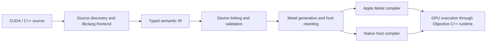

# MetalCudaTransformer

A compiler and Objective-C++ runtime that translate a supported subset of CUDA C++ to Metal for Apple Silicon GPUs.

## Why it exists

CUDA projects cannot run directly on Apple Silicon through NVIDIA's CUDA runtime.
MCU translates source code and adapts host calls so supported compute programs
can run through Metal. It operates on source, not PTX, and does not implement the
full CUDA language or runtime.

## Key capabilities

| Area | Implementation |
| --- | --- |
| Compilation | libclang semantic analysis, typed IR, device linking and source diagnostics |
| Code generation | Metal kernels, rewritten host calls, binding and symbol manifests |
| Runtime | Buffers, dispatch, synchronization, explicit streams and events |
| Compatibility | Tested subsets of atomics, shared memory, warp operations and CUDA graphs |
| Build tooling | Native executables, separate compilation, incremental caches and a limited NVCC driver |
| Libraries | Limited cuBLAS SGEMM adapter through Metal Performance Shaders |

## Architecture



The frontend collects symbols, types and source locations. IR passes validate
device calls and guide transformations. The generator emits Metal and host
bindings. The runtime manages memory and command submission. Source discovery
and some lowering paths still use textual analysis; this is not a complete
AST-only compiler. See [architecture](docs/ARCHITECTURE.md).

## Quick start

Requires macOS on Apple Silicon, Python 3.11+, Xcode and the Metal Toolchain.
NVIDIA hardware and a CUDA toolkit installation are not required.

```bash
curl -fsSL https://raw.githubusercontent.com/bogdan-svai/MetalCudaTransformer/master/scripts/bootstrap.sh | bash
export PATH="$HOME/.local/bin:$PATH"
mcu --help
```

The bootstrap downloads the source to `~/.local/share/mcu`, checks prerequisites,
creates a Python environment and installs the command in `~/.local/bin`.
It does not overwrite an existing source directory or edit your shell profile.
For a checkout, run `./install.sh`. See [installation](HOW_TO_INSTALL.md) for
Xcode setup, a selected source revision and removal.

## CUDA-to-Metal example

The [vector example](examples/vector/main.cu) applies an unsigned transform and
compares every output element with a CPU result:

```cpp
__global__ void transform(unsigned int* values, int count,
                          unsigned int factor, unsigned int addend) {
    int index = blockIdx.x * blockDim.x + threadIdx.x;
    if (index < count) values[index] = values[index] * factor + addend;
}
```

From the source directory:

```bash
./.venv/bin/python mcu check examples/vector/main.cu
./.venv/bin/python mcu build examples/vector/main.cu --native --output .mcu/vector
./.mcu/vector/main 1024 1 2 1
```

On success, the program prints `status=pass count=1024 launches=1` after checking
every output element against the CPU result. Native builds require the Metal
Toolchain and a usable Metal device.
The [demo guide](docs/DEMO.md) includes the full input, generated Metal details
and commands for inspecting output without a GPU build.

## Supported features and limitations

Run `mcu capabilities --json` for signatures and restrictions. Tests cover
selected device functions, shared memory, atomics, streams, events, warp
intrinsics and graph operations. cuBLAS support is limited to selected SGEMM
operations. Arbitrary CUDA C++, PTX and general CUDA libraries are not supported.

`check` reports constraints; it does not prove successful compilation or correct
execution. Experimental host-loop offload is disabled by default and supports a
narrow class of independent loops over local unsigned arrays. It has no measured
CPU/GPU profitability policy. See [usage](docs/USAGE.md).

## Performance benchmarks

The frontend uses persistent semantic caching. Measure its frontend phase with
empty and populated caches:

```bash
./.venv/bin/python scripts/benchmark_frontend.py --samples 5 --warmups 1 \
  --output .mcu/reports/frontend.json
```

This measures fresh and populated semantic caches in separate processes on the
current implementation. [Benchmark methodology](docs/BENCHMARKS.md) describes
the measurements and workloads with CPU correctness checks.

## Testing

```bash
./.venv/bin/python -m pip install -r requirements-dev.txt
source .venv/bin/activate
make lint
python -m pytest -q
make verify
```

The complete suite includes native compilation and GPU execution and requires
Xcode, the Metal Toolchain and GPU access. See [testing](docs/TESTING.md) for
source-only checks, native verification and CI configuration.

## Project structure

```text
cli/          Command interface
core/         Frontend, IR, passes, code generation and build tooling
runtime/      Objective-C++ Metal runtime and compatibility headers
examples/     Programs for native execution and source analysis
benchmarks/   Workloads and source attribution
scripts/      Installation, verification and measurement tools
tests/        Compiler and runtime regression tests
docs/         Architecture, usage, demo and benchmark documentation
```

## Technical design decisions

Semantic source ranges and symbol identities guide device-call rewrites and
preserve diagnostic locations. Translation-unit caches use source digests and
compilation context; affected units are relinked after changes. The runtime
keeps dispatch and synchronization separate from source translation. Rewritten
host code and generated Metal remain inspectable build artifacts. The remaining
textual paths and partial API coverage are documented in the architecture guide.

## License and contributions

No project license has been selected. Public source availability does not grant
an open-source license. Benchmark attribution remains in the relevant `NOTICE.md`
files; source provenance and redistribution terms still require owner review.

For changes, include a small reproducer, diagnostics and the checks you ran.
Follow [CONTRIBUTING.md](CONTRIBUTING.md), particularly for native or performance
changes. Do not report timing improvements without a comparable baseline and
correctness checks.
